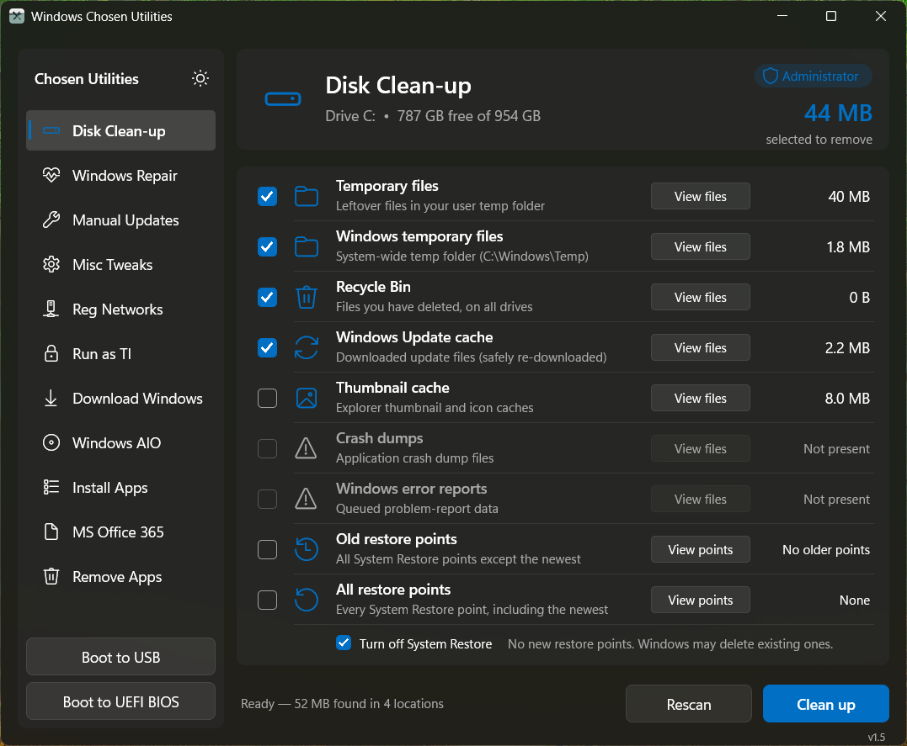
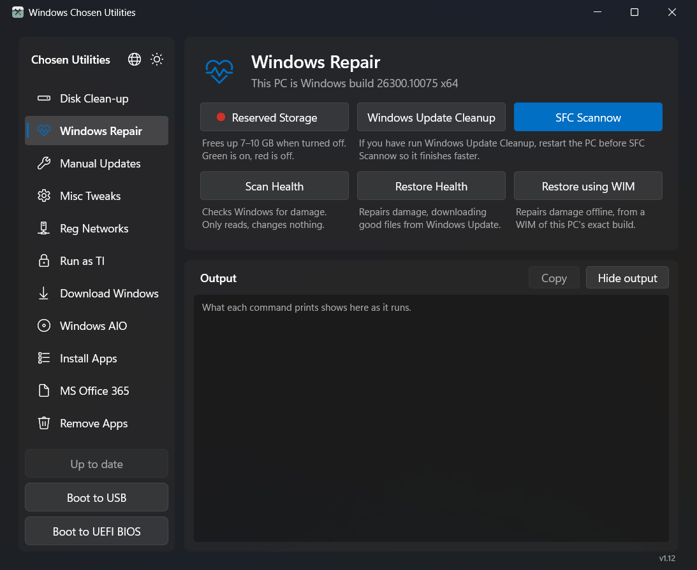
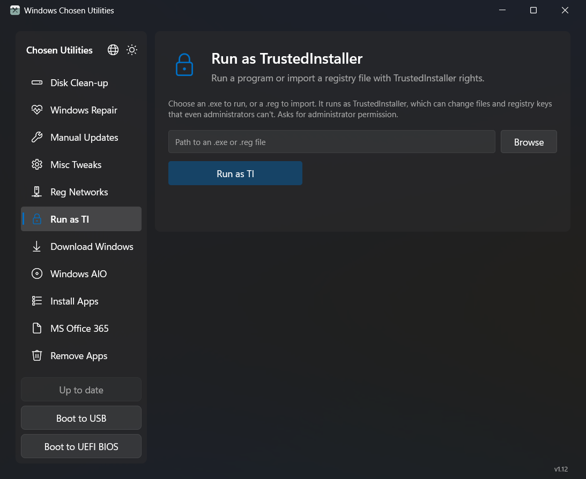
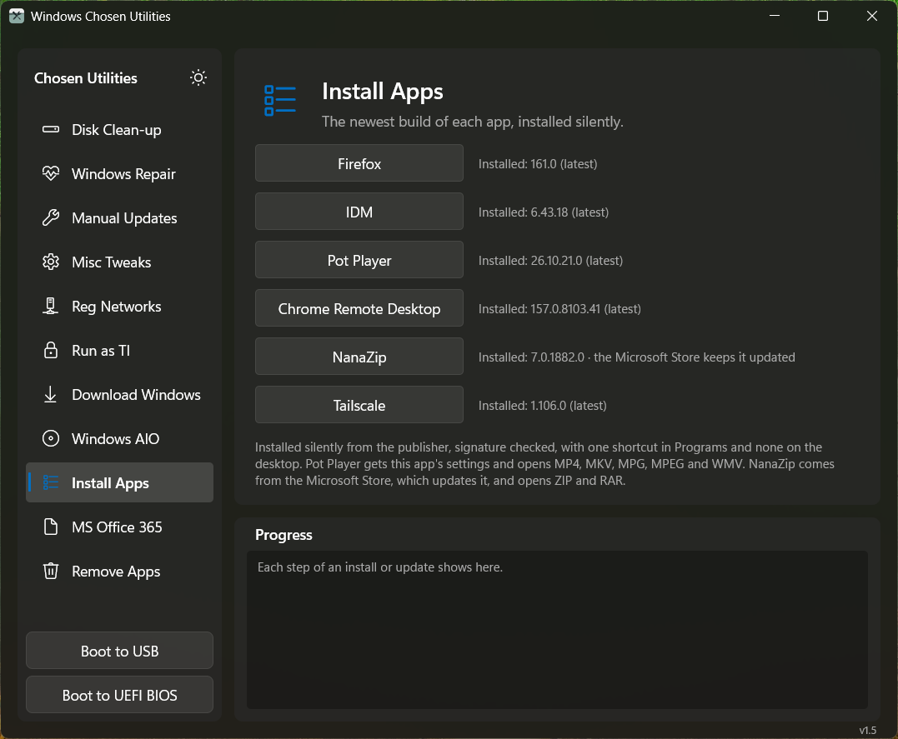
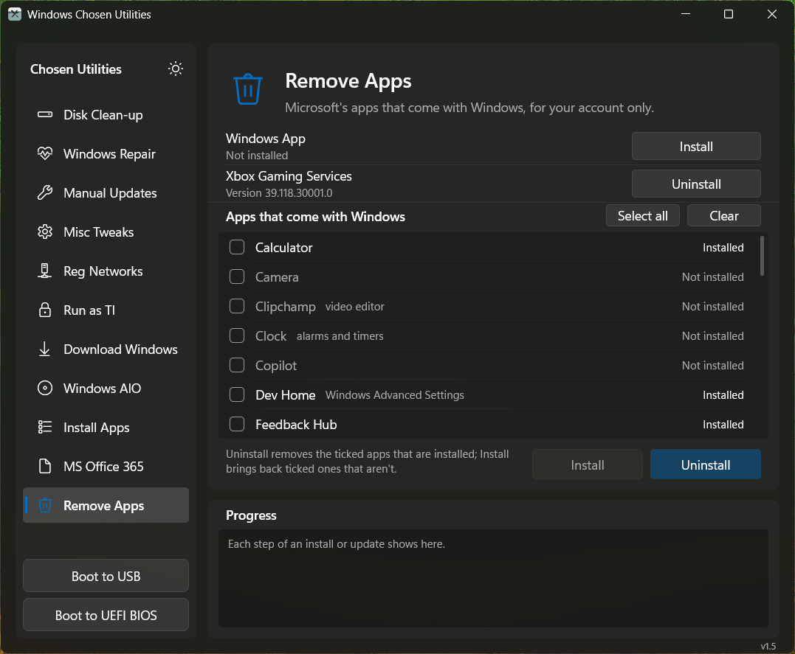

# Windows Chosen Utilities v1.7

A small, native Windows 11 app: one portable exe with no installer and no dependencies. It has a Mica window,
follows your dark/light theme and accent colour, and uses Windows 11 style dialogs. Anything that needs
administrator rights asks once through UAC.

## Download
Get `Windows.Chosen.Utilities.exe` from the [latest release](https://github.com/misal1337/windows-chosen-utilities/releases/latest)
and run it. Nothing is installed.

## Screenshots
<table>
  <tr>
    <td> <b>Windows Repair</b></td>
    <td> <b>Manual Updates</b></td>
  </tr>
  <tr>
    <td> <b>Misc Tweaks</b></td>
    <td> <b>Reg Networks</b></td>
  </tr>
  <tr>
    <td> <b>Run as TI</b></td>
    <td> <b>Download Windows</b></td>
  </tr>
  <tr>
    <td> <b>Windows AIO</b></td>
    <td> <b>Install Apps</b></td>
  </tr>
  <tr>
    <td> <b>MS Office 365</b></td>
    <td> <b>Remove Apps</b></td>
  </tr>
</table>

## Pages
- **Disk Clean-up**: clears temp files, the Recycle Bin, the Windows Update cache, the thumbnail cache, crash
  dumps, error reports and, if you tick them, System Restore points. It only touches a fixed list of locations.
- **Reg Networks**: removes the generic "Network N" profiles and opens any pasted registry key in Registry Editor.
- **Run as TI**: runs an `.exe` or imports a `.reg` as TrustedInstaller.
- **Manual Updates**: downloads the newest `.msu` and .NET (ndp481) update for this PC's channel, and installs
  `.msu`/`.cab` files with DISM.
- **Windows AIO**: WIM Editor, ESD to ISO (pick the editions to keep; runs abbodi1406's esd-decrypter-wimlib, fetched each time, and names the ISO like Download Windows), Folder2ISO / ISO2Folder, WinToUSB and Hash.
- **Windows Repair**: SFC, DISM Scan/Restore Health (also from a WIM), Windows Update Cleanup and Reserved Storage,
  with live output.
- **Misc Tweaks**: Terminal settings restore, plus Enable/Disable switches for Explore Background, Gallery, VBS,
  RDP blank password, map drives delay, WU drivers, notifications, Windows theme, and Timezone and Region.
- **Download Windows**: builds a bootable x64 or Arm64 ISO from Microsoft's files via UUP dump, with the
  editions, language and preinstalled apps you choose.
- **Install Apps**: silent installs and updates of Firefox, IDM, PotPlayer, Chrome Remote Desktop, NanaZip and
  Tailscale, with signature checks and tidy Start menu shortcuts.
- **MS Office 365**: downloads Microsoft 365 Apps (x64) from the Office CDN, installs the apps you pick, and
  switches between the Current, Beta and Dev Main channels.
- **Remove Apps**: removes the apps that come with Windows for your account, or brings them back.
- **Boot to USB** and **Boot to UEFI BIOS** (bottom of the rail): restart straight into a bootable USB stick, or into
  the firmware settings.

## Notes
- The exe is not code-signed yet, so SmartScreen may warn you on first launch: *More info → Run anyway*.
  On PCs with Smart App Control turned on, Windows blocks it until it is signed.
- Download Windows, Manual Updates and Office need the internet and rely on Microsoft's and UUP dump's servers.
- To build from source: install [Zig](https://ziglang.org/download/) (no Visual Studio needed), then `cd Source`
  and run `.\build.ps1`.

## Code signing policy
Free code signing provided by [SignPath.io](https://about.signpath.io), certificate by [SignPath Foundation](https://signpath.org).
*(Applied for; until it is approved, releases are unsigned.)*

- Committers and reviewers: [misal1337](https://github.com/misal1337)
- Approvers: [misal1337](https://github.com/misal1337)

Every release exe is built by GitHub Actions from the source in this repository
([build workflow](.github/workflows/build.yml)). Each signing request is approved by hand, and only files built
from this repository are signed.

## Privacy policy
This program will not transfer any information to other networked systems unless specifically requested by the
user or the person installing or operating it.

It collects no data and has no telemetry. When you use these features it connects to the services they need, whose
own privacy policies apply:
- **Download Windows, Manual Updates:** [UUP dump](https://uupdump.net) and Microsoft's update servers.
- **Windows AIO → ESD to ISO:** GitHub, to fetch abbodi1406's [esd-decrypter-wimlib](https://github.com/abbodi1406/BatUtil).
- **MS Office 365:** Microsoft's Office CDN. Opening this page checks it for the newest builds.
- **Install Apps:** the publishers' download servers (Mozilla, Internet Download Manager, PotPlayer/Kakao, Google,
  Tailscale) and the Microsoft Store for NanaZip. Opening this page checks those servers for the newest versions.

## What it changes on your PC
Each page says what its buttons do before you press them, and changes that need administrator rights ask through
UAC first. The Misc Tweaks Enable/Disable switches work both ways, so those changes can be undone (Terminal
Settings Restore replaces Windows Terminal's settings and doesn't keep the old file). Apps installed by Install Apps
uninstall normally from Windows Settings, and Remove Apps can reinstall what it removed.

## How it's made
Developed with the help of Claude (Anthropic's AI assistant) in Claude Code. Every change is reviewed and published
by [misal1337](https://github.com/misal1337).

## Licence
MIT; see [LICENSE](LICENSE). Two small parts come from other MIT-licensed projects and keep their own notices:
- `Source/assoc.c` (UserChoice hash) follows [PS-SFTA](https://github.com/DanysysTeam/PS-SFTA) by DanysysTeam.
- `Source/uclhash_tables.inc` comes from [cssxn/UserChoiceLatestHash](https://github.com/cssxn/UserChoiceLatestHash);
  its full notice is at the top of that file.

## Changelog
**6 Nov 2026: first build**
- Disk Clean-up, Reg Networks, the DISM install page and the Boot to UEFI button.
- Windows AIO page (WIM Editor, ESD to ISO, Folder2ISO / ISO2Folder, WinToUSB, Hash).

**7 Nov 2026**
- Restyled to the net-merge Windows 11 look: Mica, fades, DirectWrite text.
- System Restore options added to Disk Clean-up.
- Misc Tweaks page added (Terminal settings and the Enable/Disable switches).
- Download Windows page added. The DISM page was renamed Manual Updates, and the source moved to `Source`.

**8 Nov 2026**
- Manual Updates now downloads the latest `.msu` and ndp481 updates itself.
- Run as TI and Windows Repair pages added.
- Download Windows: preinstalled app picker, Arm64, more reliable downloads, nothing left in the root of C:,
  and a leftovers clean-up.
- Version label added.

**9 Nov 2026: v1.3**
- Install Apps page added, with update buttons and default file types for PotPlayer and NanaZip.
- MS Office 365 page added: download, install and channel switching.
- Windows 11 style dialogs replace message boxes, with one prompt per action. The Progress log scrolls.

**25 Nov 2026: v1.5**
- First public release, open source under the MIT licence.

**25 Nov 2026: v1.6**
- Output boxes no longer cut words in half at the end of a row.
- Download Windows: small files download first, so fewer links expire on slow connections, and expired links
  show one plain line instead of rows of 403 errors.
- If a download fails, the error says how many links Microsoft refused in the last round.
- Release builds are made by GitHub Actions, and the exe's file properties show its version.

**25 Nov 2026: v1.7**
- Runs on PCs whose processor lacks AVX2. Earlier release builds could crash at start on those.
- If a job finishes while the window is minimized, its message opens on screen. Before, it opened off the screen
  and the app couldn't be clicked.
