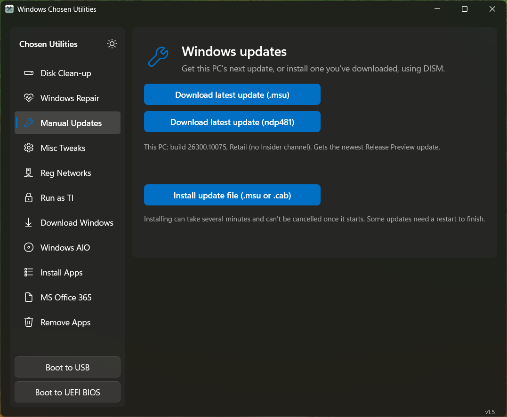
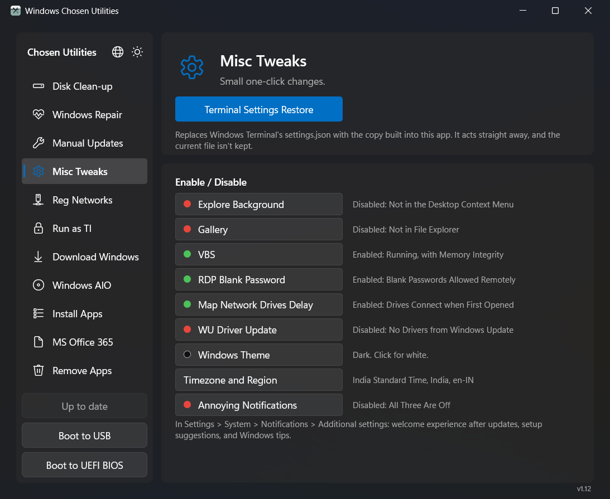
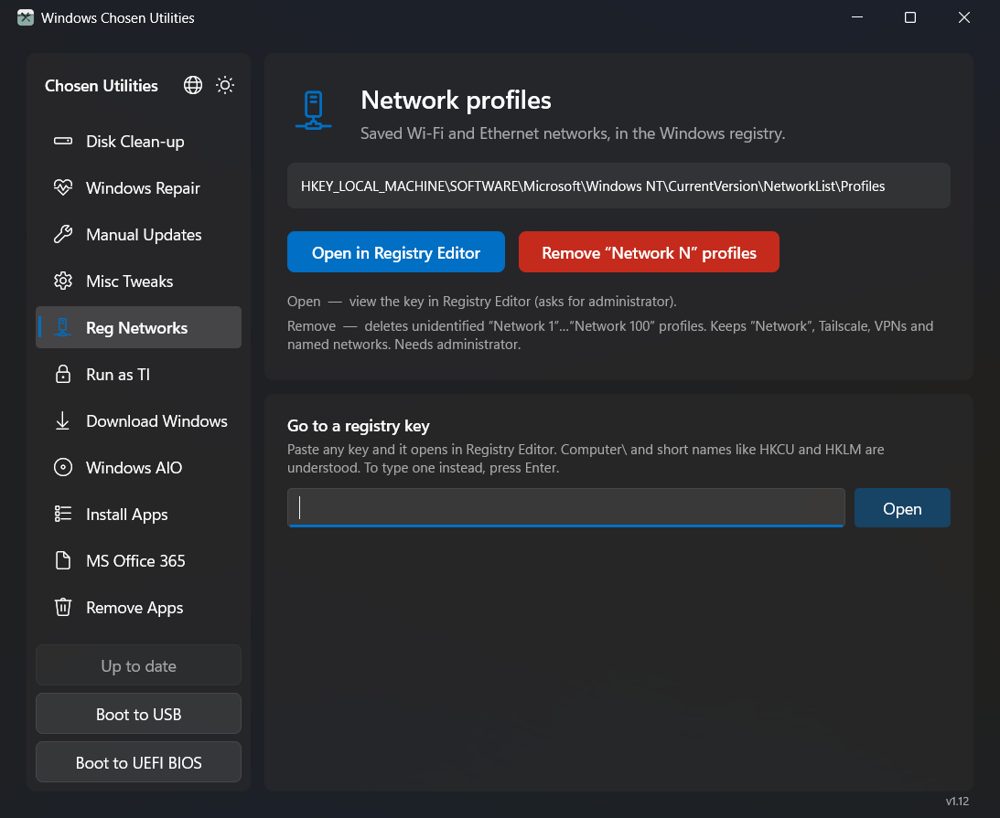
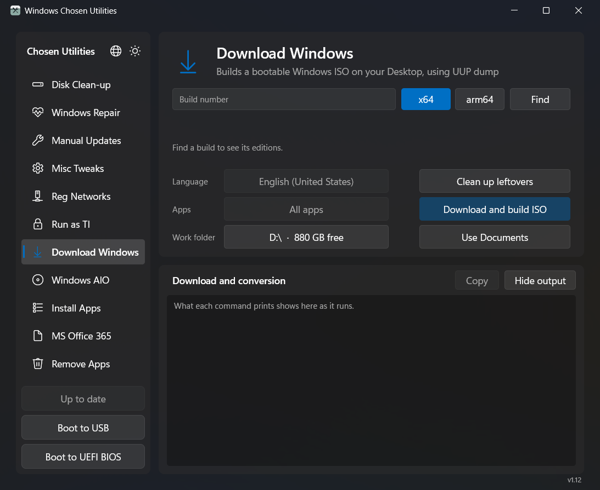
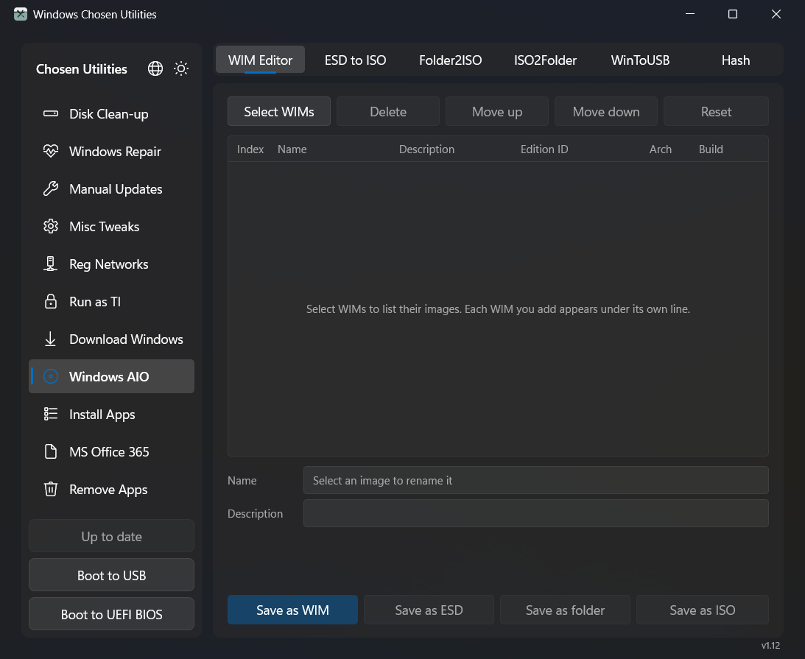
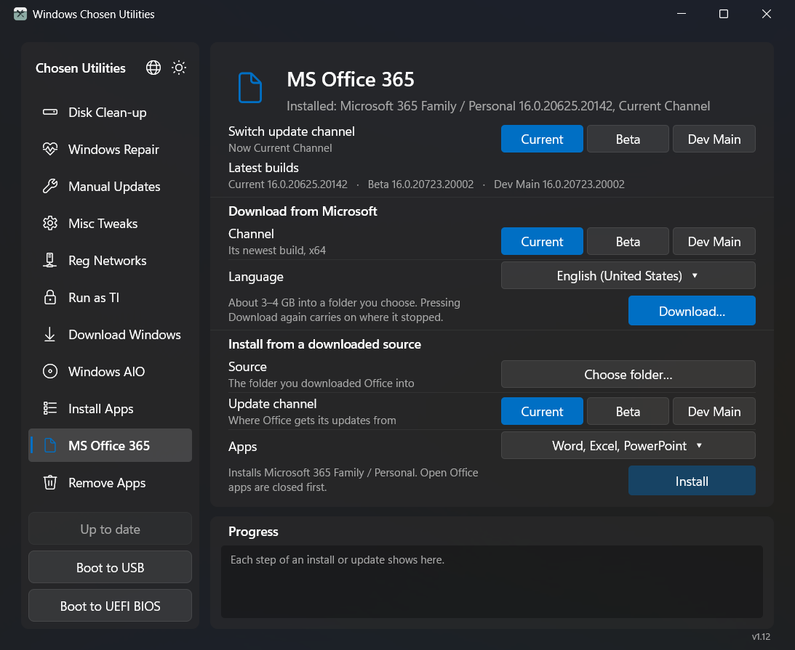

# Windows Chosen Utilities v1.14

A small, native Windows 11 app: one portable exe with no installer and no dependencies. It has a Mica window,
follows your dark/light theme and accent colour, and uses Windows 11 style dialogs. Anything that needs
administrator rights asks once through UAC.

## Download
Get `Windows.Chosen.Utilities.exe` from the [latest release](https://github.com/misal1337/windows-chosen-utilities/releases/latest)
and run it. Nothing is installed.

## Screenshots
<table>
  <tr>
    <td> <b>Windows Repair</b></td>
    <td> <b>Manual Updates</b></td>
  </tr>
  <tr>
    <td> <b>Misc Tweaks</b></td>
    <td> <b>Reg Networks</b></td>
  </tr>
  <tr>
    <td> <b>Run as TI</b></td>
    <td> <b>Download Windows</b></td>
  </tr>
  <tr>
    <td> <b>Windows AIO</b></td>
    <td> <b>Install Apps</b></td>
  </tr>
  <tr>
    <td> <b>MS Office 365</b></td>
    <td> <b>Remove Apps</b></td>
  </tr>
</table>

## Pages
- **Disk Clean-up**: clears temp files, the Recycle Bin, the Windows Update cache, the thumbnail cache, crash
  dumps, error reports and, if you tick them, System Restore points. It only touches a fixed list of locations.
- **Reg Networks**: removes the generic "Network N" profiles and opens any pasted registry key in Registry Editor.
- **Run as TI**: runs an `.exe` or imports a `.reg` as TrustedInstaller, with a clear warning about what that can break.
- **Manual Updates**: downloads the newest `.msu` and .NET (ndp481) update for this PC's channel, and installs
  `.msu`/`.cab` files with DISM.
- **Windows AIO**: WIM Editor, ESD to ISO (pick the editions to keep; runs abbodi1406's esd-decrypter-wimlib, fetched each time, and names the ISO like Download Windows), Folder2ISO / ISO2Folder, WinToUSB and Hash.
- **Windows Repair**: SFC, DISM Scan/Restore Health (also from a WIM), Windows Update Cleanup and Reserved Storage,
  with live output.
- **Misc Tweaks**: Terminal settings restore, plus Enable/Disable switches for Explore Background, Gallery, VBS,
  RDP blank password, map drives delay, WU drivers, notifications, Windows theme, and Timezone and Region.
- **Download Windows**: builds a bootable x64 or Arm64 ISO from Microsoft's files via UUP dump, with the
  editions, language and preinstalled apps you choose, in Documents or a work folder you pick.
- **Install Apps**: silent installs and updates of Firefox, IDM, PotPlayer, Chrome Remote Desktop, NanaZip and
  Tailscale on Page 1, and AB Download Manager and ArtCraft Launcher (from their GitHub releases, SHA-256 checked)
  and HWiNFO on Page 2 (its gear sets HWiNFO's on-screen display, dark mode and tray start), with signature checks and tidy Start menu shortcuts. The red × on a row uninstalls that app silently
  with its own uninstaller. **Download NVIDIA driver** and **Download AMD
  driver** find the newest driver for the graphics in this PC (desktop or laptop) and save it where you choose,
  without installing it: NVIDIA's Game Ready Driver, or a newer hotfix when there is one; AMD's Recommended driver,
  or a newer Optional one.
- **MS Office 365**: downloads Microsoft 365 Apps (x64) from the Office CDN, installs the apps you pick, and
  switches between the Current, Beta and Dev Main channels.
- **Remove Apps**: removes the apps that come with Windows for your account, or brings them back.
- **Boot to USB** and **Boot to UEFI BIOS** (bottom of the rail): restart straight into a bootable USB stick, or into
  the firmware settings.
- **Update** (bottom of the rail): turns on only when a newer release is out here, and Windows shows a notification
  then. It shows what's new, downloads the release's exe, checks it against the SHA-256 GitHub lists, swaps it in
  place of the running exe (same name and folder) and restarts. A folder that needs administrator rights asks
  through UAC first.

## Notes
- The exe is not code-signed, so SmartScreen may warn you on first launch: *More info → Run anyway*.
  On PCs with Smart App Control turned on, Windows blocks it: turn Smart App Control off in Windows Security →
  App & browser control → Smart App Control settings. On Windows 11 build 26100.8246 / 26200.8246 or later (and
  every 26300 build) it can be switched back on any time; on older builds only by resetting Windows.
- Download Windows, Manual Updates and Office need the internet and rely on Microsoft's and UUP dump's servers.
- To build from source: install [Zig](https://ziglang.org/download/) (no Visual Studio needed), then `cd Source`
  and run `.\build.ps1`.

## Release builds
Releases are not code-signed. Since v1.6, every release exe is built by GitHub Actions from the source in this
repository ([build workflow](.github/workflows/build.yml)).

## Privacy policy
This program will not transfer any information to other networked systems unless specifically requested by the
user or the person installing or operating it.

It collects no data and has no telemetry. When you use these features it connects to the services they need, whose
own privacy policies apply:
- **Update check:** GitHub's API, at start and every 6 hours while open, to read this repository's latest release.
  Nothing about you or your PC is sent with it. Pressing Update downloads the release's exe from GitHub.
- **Download Windows, Manual Updates:** [UUP dump](https://uupdump.net) and Microsoft's update servers.
- **Windows AIO → ESD to ISO:** GitHub, to fetch abbodi1406's [esd-decrypter-wimlib](https://github.com/abbodi1406/BatUtil).
- **MS Office 365:** Microsoft's Office CDN. Opening this page checks it for the newest builds.
- **Install Apps:** the publishers' download servers (Mozilla, Internet Download Manager, PotPlayer/Kakao, Google,
  Tailscale, the sac.sk mirror for HWiNFO), GitHub for AB Download Manager and ArtCraft Launcher, and the Microsoft
  Store for NanaZip.
  Opening this page checks those servers for the newest versions.
  The driver buttons ask NVIDIA's driver lookup and download server, or amd.com, only when pressed; the graphics
  card's model name is part of that question.

## What it changes on your PC
Each page says what its buttons do before you press them, and changes that need administrator rights ask through
UAC first. The Misc Tweaks Enable/Disable switches work both ways, so those changes can be undone (Terminal
Settings Restore replaces Windows Terminal's settings and doesn't keep the old file). Apps installed by Install Apps
uninstall normally from Windows Settings, and Remove Apps can reinstall what it removed.

## How it's made
Developed with the help of Claude (Anthropic's AI assistant) in Claude Code. Every change is reviewed and published
by [misal1337](https://github.com/misal1337).

## Licence
MIT; see [LICENSE](LICENSE). Two small parts come from other MIT-licensed projects and keep their own notices:
- `Source/assoc.c` (UserChoice hash) follows [PS-SFTA](https://github.com/DanysysTeam/PS-SFTA) by DanysysTeam.
- `Source/uclhash_tables.inc` comes from [cssxn/UserChoiceLatestHash](https://github.com/cssxn/UserChoiceLatestHash);
  its full notice is at the top of that file.

## Changelog
Highlights only. Every release's full notes are on the [Releases page](https://github.com/misal1337/windows-chosen-utilities/releases).

- **v1.14** (28 Nov 2026): HWiNFO on Install Apps Page 2, with a settings box for its on-screen display (up to 5
  readings, order and text size), dark mode and starting to the tray. Run as TI warns clearly before it runs
  anything. The build box on Download Windows no longer cuts its example off. The exe now has a Windows manifest,
  and downloads retry over Windows' own curl when a connection fails.
- **v1.13** (27 Nov 2026): Install Apps gets pages: Page 2 adds AB Download Manager and ArtCraft Launcher, installed
  for your account from their GitHub releases and checked against GitHub's SHA-256. Every installed app gets a small
  red × that uninstalls it silently.
- **v1.12** (27 Nov 2026): the app updates itself: an Update button in the rail and a Windows notification when a
  newer release is out, with what's new before it updates. Install Apps downloads the newest NVIDIA or AMD graphics
  driver for this PC (Game Ready or a newer hotfix; Recommended or a newer Optional), Chrome Remote Desktop updates
  to the version Google is rolling out, and links in the log copy with a click. Firefox updates with Mozilla's small
  delta update when one exists for the installed build.
- **v1.11** (26 Nov 2026): Download Windows gets a Work folder choice, edition names in the ISO's name, steadier
  progress, and the time taken plus this PC's specs in the log. IDM updates with its own update file.
- **v1.10** (25 Nov 2026): Download Windows shows progress, elapsed time and time left. Russian added.
- **v1.9** (25 Nov 2026): six languages (English, German, French, Spanish, Portuguese and Simplified Chinese).
- **v1.8** (25 Nov 2026): a finished ISO is announced on the page instead of in a box that blocked the window.
- **v1.7** (25 Nov 2026): runs on processors without AVX2; job messages no longer open off screen.
- **v1.6** (25 Nov 2026): steadier downloads on slow connections; release builds made by GitHub Actions.
- **v1.5** (25 Nov 2026): first public release, open source under the MIT licence.
- **Before v1.5** (6–9 Nov 2026): the pages were built: Disk Clean-up, Windows AIO, Misc Tweaks, Download Windows,
  Manual Updates, Run as TI, Windows Repair, Install Apps and MS Office 365, with the Windows 11 look.